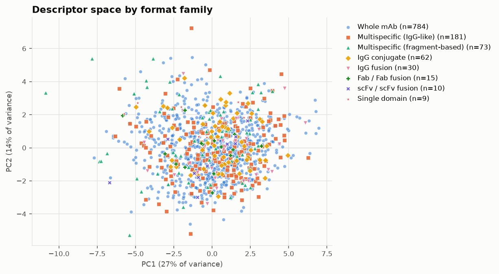
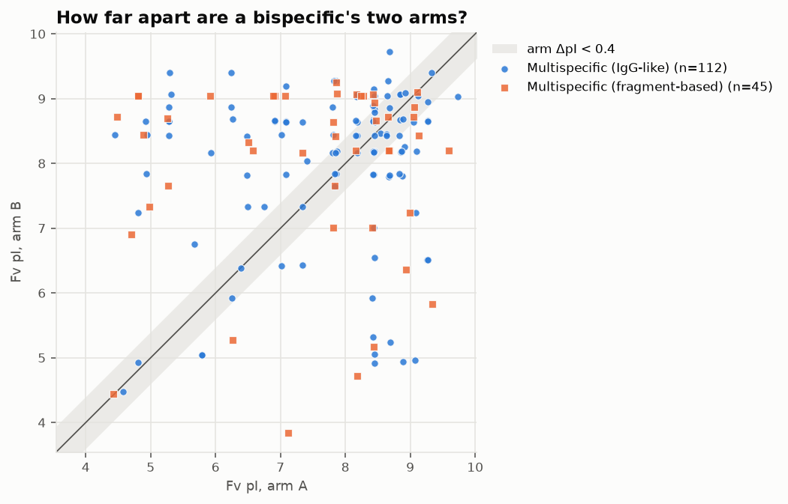

# Sequence-only descriptors of therapeutic antibody formats

A small, self-contained study of how clinical-stage antibody formats differ in the
sequence properties that drive their behaviour in downstream purification.

**Question.** Antibody platform processes are built around a handful of separations —
affinity capture, a cation- or anion-exchange step, sometimes a hydrophobic-interaction
polish — each of which resolves molecules on charge or on exposed apolar surface. If a
molecule's format (whole IgG, Fab, scFv, single domain, bispecific) carried a
characteristic charge and hydrophobicity signature, format alone would narrow the
process design. Does it? This project computes the descriptors from public sequences
and lets unsupervised methods answer, rather than assuming.

**Hypothesis under test.** Format should be only weakly recoverable from these
descriptors, because they are computed on the variable domain while format is largely
a constant-region decision. If that holds, the practical conclusion is that a
per-molecule descriptor is worth more to process development than a per-format rule of
thumb. The analysis script prints the numbers that confirm or refute it; the Results
section below is filled in from that output rather than asserted here.

---

## Data

[Thera-SAbDab](https://opig.stats.ox.ac.uk/webapps/sabdab-sabpred/therasabdab/search/)
(Raybould et al., *Nucleic Acids Research* 2020), the therapeutic subset of SAbDab,
downloaded directly from OPIG. Every clinical-stage antibody therapeutic with its
variable-domain sequences, format, isotype, light-chain class, molecular origin and
highest clinical phase.

The table is reshaped to one row per **variable-domain arm**: a bispecific contributes
two arms, since a descriptor is a property of an arm rather than of a trade name.
The free-text `Format` field (over a hundred distinct strings) is collapsed into
engineering families — whole mAb, IgG conjugate, IgG fusion, multispecific (IgG-like),
multispecific (fragment-based), Fab, scFv, single domain — in
[`classify_format`](src/abdev/dataset.py).

## Descriptors

All sequence-only, so they apply to every entry with no structure available
([`src/abdev/descriptors.py`](src/abdev/descriptors.py)).

| Group | Descriptors | Why it matters downstream |
|---|---|---|
| Charge | pI of the Fv and of each chain, net charge at pH 3.6 / 5.5 / 7.4, charge per kDa, fraction of K+R and D+E, charge asymmetry | pI relative to buffer pH sets the sign of binding on an ion exchanger and the window between elution and aggregation |
| Charge patches | most positive and most negative 7-residue windowed charge | local patches, not net charge, drive ion-exchange retention and non-specific binding |
| Hydrophobicity | GRAVY, largest 7-residue Kyte–Doolittle window, aromatic fraction, Eisenberg hydrophobicity index over the whole Fv and over the loops | HIC retention and aggregation propensity track exposed apolar surface |
| Loops | total loop length, CDR-H3 length and charge, loop positive fraction, loop aromatic content | the loops are the most variable and most exposed part of the Fv, and carry the patch character that distinguishes otherwise similar frameworks |
| Liabilities | glycosylation sequons, Asn deamidation and Asp isomerisation motifs, Met/Trp in loops, cysteine count | charge- and mass-variant heterogeneity that a process has to resolve |
| Framework | VH3-type framework flag | the framework family affects how the molecule behaves on affinity capture |

Charge is computed by Henderson–Hasselbalch over EMBOSS side-chain pKa values, with
pI by bisection on the net-charge curve; multi-chain molecules are passed as separate
chains so that each contributes its own pair of termini
([`src/abdev/charge.py`](src/abdev/charge.py)).

Loops are located from conserved anchors — the framework cysteines, the Trp after
CDR-1, and the WGxG / FGxG framework-4 motifs — rather than by full numbering
([`src/abdev/regions.py`](src/abdev/regions.py)). Every call reports whether the loops
it found have plausible lengths, and arms that fail are excluded from loop-dependent
descriptors instead of being silently assigned nonsense. The boundaries are checked
in the test suite against published Kabat/AbM loops for trastuzumab and adalimumab.

## Method

1. Build the descriptor table (`scripts/01_build_dataset.py`).
2. Split descriptors into those defined for every arm and those needing a resolved
   loop set or a light chain. The second group is analysed on its subset rather than
   imputed, so single-domain formats are not quietly given invented light-chain values.
3. Prune descriptor pairs correlating above |r| = 0.95, which otherwise let a block of
   near-duplicates decide PC1 by weight of numbers.
4. Standardise, then PCA. Report explained variance and the loadings that define each
   component.
5. k-means and Ward clustering in the leading PCA dimensions, swept over k, scored by
   silhouette (are the clusters real?) and by adjusted Rand / adjusted mutual
   information against the format label (do they mean anything?). A label-shuffled
   baseline confirms the chance correction behaves.
6. The same agreement test against isotype, light-chain class and molecular origin, to
   see whether the clusters track some other annotation instead.

Everything quoted in this README is printed by `scripts/02_analyse.py`, so the numbers
cannot drift away from the code.

## Results

Run `scripts/02_analyse.py`; it writes the figures below and the tables in `results/`.

| Figure | Shows |
|---|---|
| `figures/01_pca_scree.png` | variance carried by each component |
| `figures/02_pca_by_format.png` | PC1 vs PC2, coloured by format family |
| `figures/03_loadings_pc1.png`, `03_loadings_pc2.png` | which descriptors define each component |
| `figures/04_cluster_k_sweep.png` | silhouette and agreement-with-format across k |
| `figures/05_pI_by_format.png`, `05_hydrophobic_patch_by_format.png` | the two process-relevant descriptors by format |
| `figures/06_cluster_composition.png` | what each cluster is made of |
| `figures/07_bispecific_arm_pI.png` | Fv pI of one bispecific arm against the other |
| `figures/08_bispecific_homodimer_charge_gap.png` | charge handle against heavy-chain homodimers |

**Data.** 1,164 variable-domain arms from 1,069 clinical-stage therapeutics (Thera-SAbDab,
Feb 2025 release): 1,124 paired VH/VL, 40 heavy-only. The anchor rules resolved all
loops for 884 arms (75.9%). 26 descriptors are defined for every arm; 4 were dropped as
near-duplicates (|r| > 0.95), leaving 22 for PCA.

**What varies is charge, then hydrophobicity.** PC1 (27% of variance) is a charge axis:
net charge at pH 5.5 and 7.4, charge density at pH 3.6, and Fv pI all load at +0.34 to
+0.39. PC2 (14%) contrasts acidic-residue content against hydrophobicity (GRAVY and the
Eisenberg index load at −0.45). PC3 (10%) is size and composition (sheet fraction, length,
aromatics, cysteines). The first three components carry 51%.

**Format is barely recoverable — as hypothesised.**



| Agreement of k = 5 clusters with… | ARI | AMI |
|---|---|---|
| format family (k-means) | +0.019 | +0.062 |
| format family (Ward) | +0.028 | +0.065 |
| label-shuffled baseline | −0.000 (sd 0.005) | — |
| isotype | +0.007 | +0.005 |
| light-chain class | +0.054 | +0.085 |
| molecular origin | +0.023 | +0.037 |

Silhouette is modest at every k (0.17–0.24), and ARI against format never exceeds 0.033
across k = 2–10. Median descriptors are near-identical across format families (Fv pI
8.16–8.44 for every family with n ≥ 9). The clusters track light-chain class slightly
better than they track format.

**What the clusters actually capture.**

- **An acidic-Fv cluster** (cluster 0, 226 arms, median pI 5.3 against 7.8–8.7 elsewhere,
  net charge ≈ 0 at pH 5.5). It draws 13–21% of every format family's arms. In process
  terms these molecules sit on the other side of a standard cation-exchange load pH from
  the majority, so the step mode (bind/elute vs flow-through, CEX vs AEX) is a
  per-molecule decision that format does not predict.
- **A heavy-only cluster** (cluster 1, 37 arms, 37 of the 40 unpaired arms), separated
  mainly by Fv length. This is the only place format "separates", and it is a
  consequence of the missing light chain rather than of distinct surface chemistry.
- Three further clusters split the basic majority by charge level (median pI 7.8 / 8.2 /
  8.7) and by the size of the largest hydrophobic window.

**Takeaway for process development.** Within the variable domain, the charge and
hydrophobicity variation that a purification step responds to is spread across every
format rather than concentrated in any of them. A per-molecule descriptor is therefore
more informative than a per-format rule of thumb — which is the starting point for
sequence-based purification modelling. The next section applies that to bispecifics.

### Bispecifics: charge separation from mispaired species

For a two-arm bispecific AB with identical constant regions, the Fv charge of homodimer
AA is 2·q_A and of the product AB is q_A + q_B, so the product-to-homodimer charge
difference is exactly |q_A − q_B|. A light-chain mispair differs by
|q(VL_A) − q(VL_B)|, zero by construction for common-light-chain formats. Both are
computed in [`src/abdev/bispecific.py`](src/abdev/bispecific.py).

157 bispecifics have both arms sequenced: 112 IgG-like, 45 fragment-based; 24 with a
common light chain, 115 with two distinct light chains, 18 with a heavy-only arm.

| Fv-level separation, product vs. mispaired species | median | IQR |
|---|---|---|
| ΔpI between the two arms | 0.80 | 0.32–2.14 |
| pI gap, product to nearest homodimer | 0.33 | 0.13–0.63 |
| charge gap to homodimer at pH 5.5 (e) | 2.87 | 1.06–4.79 |
| charge gap to LC mispair at pH 5.5 (e), distinct LCs | 1.89 | 0.13–2.94 |



Taking one elementary charge at pH 5.5 as an illustrative threshold (not a process
limit): 35 of 157 molecules (22%) fall below it against their homodimers, rising to 26%
among IgG-like bispecifics; 51 (32%) have a product-to-homodimer pI gap under 0.2. Of
the 115 with two distinct light chains, 33 (29%) sit below the threshold against
light-chain mispairs, and 12 are below it for both. The spread runs from arms that are
charge-identical to gaps above 10 e, and format family does not predict where a
molecule falls — the same per-molecule conclusion as above, one level down.

This is a sequence-level estimate only. Constant-region heterodimerisation and
pI-shifting mutations are invisible in Thera-SAbDab and can add to or replace the Fv
contribution, so the numbers bound what the variable domains contribute rather than
predicting a separation.

## Limitations

Stated plainly, because they decide how far the result can be pushed:

- **Sequence, not structure.** Windowed sums are a crude stand-in for a surface patch.
  Patch descriptors computed on a structure or homology model (as in TAP) are the
  correct version of this, and would change the hydrophobicity conclusions most.
- **Variable domains only.** Thera-SAbDab gives the variable domains; the constant
  regions, glycans and linkers that distinguish formats most sharply are not in the
  data. This bounds how well format *could* be recovered, and is part of why the
  agreement with format is weak.
- **Heuristic loop boundaries.** The anchor rules are checked against known antibodies
  but are not numbering. ANARCI/IMGT numbering is the obvious upgrade and would also
  give framework-position descriptors.
- **No experimental endpoint.** Nothing here is validated against measured retention,
  HIC times, aggregation or yield. The descriptors are a feature set awaiting a label;
  with in-house process data they become a supervised model, which is the interesting
  version of the problem.
- **Clinical-stage survivorship.** These molecules already passed developability
  screening, so the descriptor ranges are narrower than for a naive library.

## Next steps

1. Numbering-based regions (ANARCI) and structure-based patches on homology models.
2. Supervised modelling against a measured endpoint — HIC retention or Protein A
   elution pH — starting with the published datasets, then in-house data.
3. Predicted elution-pH windows per molecule, as the practically useful output: a
   charge curve per arm already gives a first estimate of where a molecule binds and
   releases on an ion exchanger.
4. For bispecifics, extend the arm-to-arm calculation to the full construct once
   constant-region sequences are available, so engineered pI shifts are included, and
   check the predicted ranking against measured homodimer clearance.

## Running it

```bash
python -m venv .venv && source .venv/bin/activate  # Windows: .venv\Scripts\activate
pip install -r requirements.txt
python scripts/01_build_dataset.py                 # downloads Thera-SAbDab, writes data/processed/
python scripts/02_analyse.py                       # PCA, clustering, figures/ and results/
python scripts/03_bispecific.py                    # arm-to-arm charge separation
pytest -q                                          # descriptor, loop-boundary and pairing checks
```

```
src/abdev/
  scales.py        amino-acid property scales and pKa values
  charge.py        charge curves, pI by bisection, windowed patches
  regions.py       CDR location from conserved anchors, with plausibility checks
  descriptors.py   the descriptor set for one Fv
  dataset.py       Thera-SAbDab loading, arm explosion, format families
  analysis.py      collinearity pruning, PCA, clustering, agreement metrics
  bispecific.py    arm-to-arm charge separation from mispaired species
  plots.py         figures
scripts/           the three-step pipeline
tests/             descriptor and loop-boundary tests
```

## References

- Raybould et al. (2020) Thera-SAbDab: the Therapeutic Structural Antibody Database.
  *Nucleic Acids Research* 48:D383–D388.
- Dunbar et al. (2014) SAbDab: the structural antibody database.
  *Nucleic Acids Research* 42:D1140–D1146.
- Raybould et al. (2019) Five computational developability guidelines for therapeutic
  antibody profiling. *PNAS* 116:4025–4030.
- Sharma et al. (2014) In silico selection of therapeutic antibodies for development:
  viscosity, clearance, and disposition. *PNAS* 111:18601–18606.
- Jain et al. (2017) Biophysical properties of the clinical-stage antibody landscape.
  *PNAS* 114:944–949.
- Kyte & Doolittle (1982) A simple method for displaying the hydropathic character of
  a protein. *Journal of Molecular Biology* 157:105–132.

Licence: MIT. Thera-SAbDab is redistributed under its own terms; the raw download is
not committed, only the code that fetches it.
